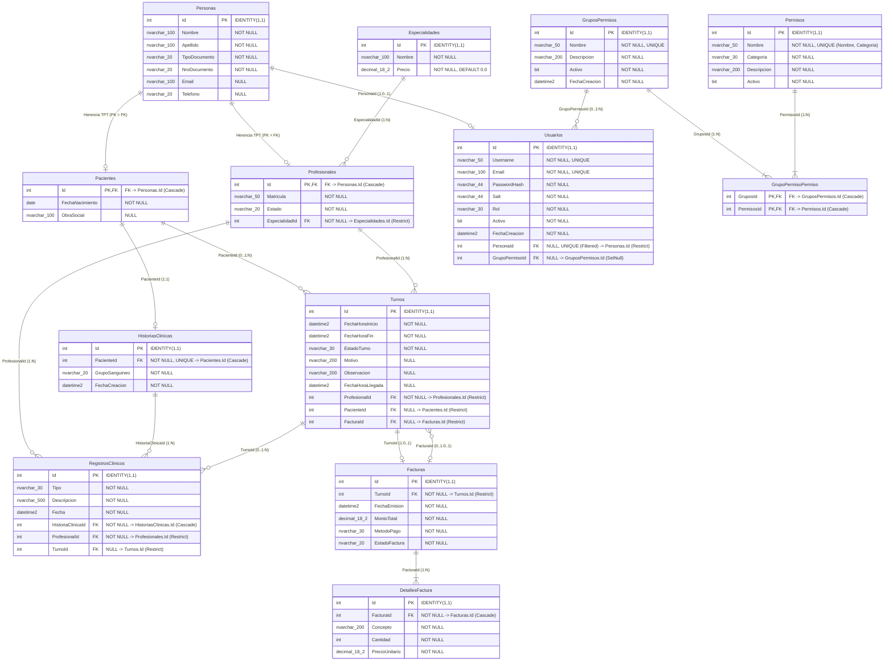

# Documentación del Proyecto Integrador (TPI)

## a. Carátula

- **Institución:** Universidad Tecnológica Nacional (UTN)
- **Asignatura:** Tecnologías de Desarrollo de Software IDE
- **Comisión:** 3EK01
- **Docentes:** Ezequiel Porta y Severino Guimpel
- **Integrantes:**
  - Alejo Mistraletti (Legajo: 52665)
  - Marco Bernaus (Legajo: 52172)

---

## b. Descripción general del sistema

Sistema de gestión para consultorios médicos que permite administrar pacientes, profesionales, especialidades, turnos y su facturación. El sistema centraliza los datos médicos de cada paciente en una Historia Clínica, la cual agrupa todas sus consultas a lo largo del tiempo, mientras que un módulo administrativo paralelo gestiona el cobro y estado de cuenta de las prestaciones realizadas.

### 1. Requerimientos Funcionales

1. **Autenticación de Usuarios (Login):**
   - El sistema cuenta con control de acceso restrictivo mediante pantalla de autenticación (`LoginForm` en la aplicación de escritorio Windows Forms y `/login` en la aplicación web Blazor Server).
   - Solo pueden acceder al sistema aquellos usuarios previamente registrados en la base de datos que se encuentren en estado `Activo`.
   - Las contraseñas se almacenan protegidas mediante salting criptográfico aleatorio y hashing SHA-256 (`Usuario.PasswordHash` y `Usuario.Salt`). La autenticación se valida en la API REST emitiendo un token seguro JWT para la sesión.

2. **Tipos de Usuario y Autorización (Roles y Permisos):**
   - El sistema implementa autorización granular basada en roles (RBAC) con tipos de usuario claramente diferenciados en sus capacidades operativas:
     - **Administrativo:** Responsable de la recepción y administración general. Gestiona los datos maestros (Especialidades, Profesionales, Pacientes), administra la agenda de turnos (creación de turnos, asignación a pacientes, liberación y registro de llegada a sala de espera), emite y anula comprobantes de facturación y accede a los reportes.
     - **Profesional (Médico):** Accede de forma exclusiva a su agenda personal de turnos asignados. Puede cambiar el estado del turno a `Atendido`, visualizar los antecedentes médicos en la Historia Clínica digital del paciente y redactar diagnósticos, evoluciones y notas clínicas.

3. **6 CRUDs:**
   1. **CRUD Pacientes:** Gestión integral de pacientes (filiación, tipo y nro. de documento, obra social, contacto y fecha de nacimiento).
   2. **CRUD Profesionales:** Alta, baja lógica (estado `Activo`/`Inactivo`), edición y consulta de médicos, con asignación de matrícula profesional y especialidad médica.
   3. **CRUD Especialidades:** Administración de las especialidades médicas del centro de salud y fijación de sus aranceles estándar de consulta.
   4. **CRUD Turnos:** Creación de espacios de agenda médica, asignación a pacientes, seguimiento de estados del flujo de atención (`Libre`, `Asignado`, `Presente`, `Atendido`, `Ausente`) y liberación/cancelación.
   5. **CRUD Registros Clínicos (Historia Clínica):** Gestión de entradas clínicas inmutables (diagnósticos, antecedentes, alergias, tratamientos y notas) asociadas a la historia clínica del paciente, vinculadas al turno atendido y al profesional firmante.
   6. **CRUD Facturación:** Emisión, consulta, detalle y anulación de comprobantes de cobro de consultas médicas.

4. **Búsqueda con Filtros y Patrón Relacional Maestro/Detalle:**
   - **Búsqueda con Filtros:** Implementada en:
     - **Agenda de Turnos:** Búsqueda y filtrado dinámico multidimensional por rango de fechas (desde/hasta), profesional seleccionado y estado asistencial del turno (`Libre`, `Asignado`, `Presente`, `Atendido`, `Ausente`).
     - **Búsqueda de Pacientes:** Búsqueda con criterios múltiples por número de documento, nombre, apellido u obra social (`PacienteCriteria`).
   - **Patrón Maestro/Detalle:** Implementado en el módulo de **Facturación**:
     - **Maestro (Cabecera):** Entidad `Factura` que centraliza `TurnoId`, `FechaEmision`, `MontoTotal`, `MetodoPago` y `EstadoFactura`.
     - **Detalle (Renglones):** Entidad `DetalleFactura` que modela cada prestación facturada con `Concepto`, `Cantidad`, `PrecioUnitario` y cálculo dinámico de `Subtotal`, manteniendo consistencia transaccional y actualización automática del monto total de la cabecera.

5. **Reportes del Sistema (Mínimo 2 Reportes, incluyendo gráficos):**
   - **Reporte 1: Tablero de Turnos y Métricas de Atención:**
     - Permite filtrar por rango de fechas (desde/hasta), profesional y especialidad.
     - Presenta métricas sobre la atención de turnos (total de turnos, tasa de asistencia efectiva y ausentismo).
     - **Gráfico Estadístico:** Genera un gráfico de torta (Pie Chart) generado con **OxyPlot** a formato vectorial SVG e incrustado directamente en el reporte PDF / visualizado en pantalla mediante WebView2, ilustrando el porcentaje de turnos por cada estado asistencial.
   - **Reporte 2: Reporte de Facturación y Liquidaciones:**
     - Permite filtrar por rango de fechas (desde/hasta), profesional y estado de la facturación.
     - Resumen económico de recaudación por período seleccionado.
     - Detalla subtotales por profesional, especialidad y método de pago (Efectivo, Tarjetas, Transferencia), generando comprobantes y resúmenes ejecutivos en PDF mediante **QuestPDF**.

---

### 2. Requerimientos Técnicos

1. **Soporte Dual Desktop y Web:**
   - **Cliente Desktop:** Desarrollado en **Windows Forms** (.NET 8 Windows Desktop), diseñado para la operación administrativa rápida en el mostrador del consultorio (gestión de agenda, asignación ágil y visor de reportes con WebView2).
   - **Cliente Web:** Desarrollado en **Blazor Server** (.NET 8 con Bootstrap 5), accesible desde navegadores web para profesionales médicos y personal remoto, con diseño responsivo y componentes interactivos.

2. **Acceso a Datos Mixto: ADO.NET y Entity Framework Core:**
   - **ADO.NET (`Microsoft.Data.SqlClient`):** Se utilizó de forma pura en `Data/EspecialidadRepository.cs`, gestionando explícitamente `SqlConnection`, `SqlCommand`, `SqlDataReader` y consultas parametrizadas seguras para todas las operaciones del catálogo de Especialidades y en consultas específicas de `Data/PacienteRepository.cs`.
   - **Entity Framework Core 8:** Empleado como ORM principal para el resto del modelo de datos (`TPIContext`), soportando mapeo Code-First, migraciones estructuradas y herencia Table-Per-Type (TPT) en `Personas`/`Pacientes`/`Profesionales`.

3. **Validaciones en UI y en el Modelo de Dominio / Lógica de Negocios:**
   - **Validaciones en UI (Capa de Presentación):**
     - En **Windows Forms:** Uso de `ErrorProvider`, validación de campos obligatorios en formularios modales (`TurnoModalForm`, `ProfesionalModalForm`, `FacturaModalForm`), validación de formatos de fecha, documento y montos numéricos, y manejo unificado de excepciones visuales mediante `UiErrorHandler`.
     - En **Blazor Server:** Formularios tipados `EditForm` con `DataAnnotationsValidator`, validación de formatos de email, requeridos y resumen visual de errores (`ValidationSummary`).
   - **Validaciones en el Modelo de Dominio / Lógica de Negocio (Capa de Dominio y Servicios):**
     - **Invariantes en Entidades de Dominio:** En `Turno`, validación estricta de la máquina de estados asistencial (solo se puede asignar si el turno está `Libre` y su fecha no ha pasado; solo se pueden asentar registros clínicos si está `Atendido`; no se puede liberar un turno con factura activa); en `Factura`, verificación de que cantidades y precios unitarios sean estrictamente mayores a cero; en `Usuario`, validación de formato de email y longitud mínima de credenciales; en `Persona`, obligatoriedad de datos filiatorios.
     - **Servicios de Aplicación:** En `Application.Services`, control de solapamiento de horarios en la agenda médica de los profesionales, unicidad de documento de identidad y matrícula médica durante el alta.

---

## c. Capturas de pantalla

Capturas de pantalla en la carpeta /Docs/images o [Link del Drive](https://drive.google.com/drive/folders/1dPHkfuEo9Vs_vEPU8kJpsTe0QOuyq4If?usp=drive_link)

---

## d. Modelo de datos (Diagrama Tablas y Relaciones - Base de Datos)

### Diagrama Entidad-Relación (DER)

### Diccionario de Tablas

| Tabla                     | Clave Primaria (PK)      | Claves Foráneas (FK)                                                                                                    | Regla de Borrado                                 |
| ------------------------- | ------------------------ | ----------------------------------------------------------------------------------------------------------------------- | ------------------------------------------------ |
| **`Personas`**            | `Id` (Identity)          | -                                                                                                                       | -                                                |
| **`Pacientes`**           | `Id`                     | `Id` $\to$ `Personas.Id`                                                                                                | `CASCADE`                                        |
| **`Profesionales`**       | `Id`                     | `Id` $\to$ `Personas.Id`, `EspecialidadId` $\to$ `Especialidades.Id`                                                    | `CASCADE` (Persona), `RESTRICT` (Especialidad)   |
| **`Usuarios`**            | `Id` (Identity)          | `PersonaId` $\to$ `Personas.Id`, `GrupoPermisoId` $\to$ `GruposPermisos.Id`                                             | `RESTRICT` (Persona), `SET NULL` (Grupo)         |
| **`Especialidades`**      | `Id` (Identity)          | -                                                                                                                       | -                                                |
| **`Permisos`**            | `Id` (Identity)          | -                                                                                                                       | -                                                |
| **`GruposPermisos`**      | `Id` (Identity)          | -                                                                                                                       | -                                                |
| **`GrupoPermisoPermiso`** | `(GruposId, PermisosId)` | `GruposId` $\to$ `GruposPermisos.Id`, `PermisosId` $\to$ `Permisos.Id`                                                  | `CASCADE` / `CASCADE`                            |
| **`Turnos`**              | `Id` (Identity)          | `ProfesionalId` $\to$ `Profesionales.Id`, `PacienteId` $\to$ `Pacientes.Id`, `FacturaId` $\to$ `Facturas.Id`            | `RESTRICT` en todas las FKs                      |
| **`HistoriasClinicas`**   | `Id` (Identity)          | `PacienteId` $\to$ `Pacientes.Id`                                                                                       | `CASCADE`                                        |
| **`RegistrosClinicos`**   | `Id` (Identity)          | `HistoriaClinicaId` $\to$ `HistoriasClinicas.Id`, `ProfesionalId` $\to$ `Profesionales.Id`, `TurnoId` $\to$ `Turnos.Id` | `CASCADE` (HC), `RESTRICT` (Profesional y Turno) |
| **`Facturas`**            | `Id` (Identity)          | `TurnoId` $\to$ `Turnos.Id`                                                                                             | `RESTRICT`                                       |
| **`DetallesFactura`**     | `Id` (Identity)          | `FacturaId` $\to$ `Facturas.Id`                                                                                         | `CASCADE`                                        |

---

## e. Modelo de Dominio

---

## f. Arquitectura implementada

1. **`Domain.Model` (Capa de Dominio):** Entidades de negocio independientes de infraestructura y frameworks de persistencia.
2. **`Data` (Capa de Acceso a Datos):** Configuración de persistencia mediante EF Core 8 (`TPIContext`), mapeo Fluent API, repositorios tipados e interfaces de persistencia (`IPacienteRepository`, `ITurnoRepository`, etc.).
3. **`Application.Services` (Capa de Servicios de Aplicación):** Casos de uso de la aplicación, orquestación de transacciones, validaciones de servicio y generación de reportes en PDF (`ReportePdfService` con QuestPDF).
4. **`DTOs` (Data Transfer Objects):** Modelos planos de transferencia desacoplados para la comunicación entre la API y clientes.
5. **`WebAPI` (Capa de Exposición de Servicios):** Endpoints RESTful con autenticación y autorización basada en JSON Web Tokens (JWT).
6. **`API.Clients`:** Clientes HTTP tipados que encapsulan las llamadas a la API REST para los clientes de presentación.
7. **Presentación:**
   - **`WindowsForms`:** Aplicación de escritorio orientada a la gestión administrativa local rápida y gestión de agenda.
   - **`Blazor.Server`:** Aplicación web interactiva basada en componentes Razor para el acceso distribuido de profesionales y pacientes.

---

## g. Tecnologías utilizadas

- **IDE:** Visual Studio 2022
- **Lenguaje & Framework:** C# 12 / .NET 8.0 SDK
- **Base de Datos & ORM:** Microsoft SQL Server 2022, Entity Framework Core 8.0.8 (Code-First & Migraciones)
- **Web API & Seguridad:** ASP.NET Core Minimal APIs, Autenticación JWT.
- **Frontend Web:** Blazor Server
- **Frontend Escritorio:** Windows Forms
- **Generación de Reportes / PDF:** QuestPDF y OxyPlot.Core
- **Testing:** xUnit, Moq, FluentAssertions
- **Control de Versiones & Diagramación:** Git, GitHub, Mermaid.js

---

## h. Enlace al repositorio de código fuente

- Repositorio del proyecto: _(https://github.com/AlejoMistra/TPI.NET)_
