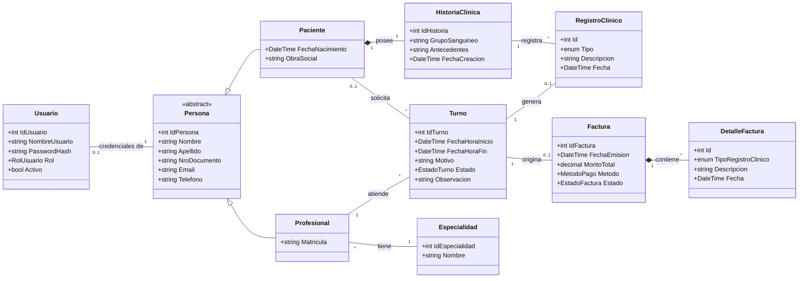

# Documentación del Proyecto Integrador (TPI)

## a. Carátula

- **Institución:** Universidad Tecnológica Nacional (UTN)
- **Asignatura:** Tecnologías de Desarrollo de Software IDE
- **Comisión:** 3EK01
- **Docentes:** Ezequiel Porta y Severino Guimpel
- **Integrantes:**
  - Alejo Mistraletti (Legajo: 52665)
  - Marco Bernaus (Legajo: 52172)

---

## b. Descripción general del sistema

Sistema de gestión para consultorios médicos que permite administrar pacientes, profesionales, especialidades, turnos y su facturación. El sistema centraliza los datos médicos de cada paciente en una Historia Clínica, la cual agrupa todas sus consultas a lo largo del tiempo, mientras que un módulo administrativo paralelo gestiona el cobro y estado de cuenta de las prestaciones realizadas.

### i. Requerimientos funcionales y no funcionales

- **Requerimientos Funcionales:**
  - Autenticación y control de accesos por roles (Administrativo, Profesional, Paciente).
  - Gestión de datos maestros (Profesionales, Especialidades y Pacientes).
  - Agenda y gestión de turnos: asignación, registro de llegada (presentismo), atención clínica, cancelación/liberación y registro de ausencias.
  - Historia clínica digital: adición y consulta cronológica de evoluciones, diagnósticos, alergias y antecedentes médicos vinculados al turno atendido.
  - Facturación con patrón Maestro/Detalle: generación de facturas con aranceles por especialidad y métodos de pago múltiples.
  - Reportes gerenciales y estadísticos en escritorio y web (exportación a PDF de comprobantes y métricas de atención).
- **Requerimientos No Funcionales:**
  - Persistencia relacional en Microsoft SQL Server con Entity Framework Core 8 y seed de datos iniciales.
  - Arquitectura multicapa desacoplada: Presentación dual (Windows Forms y Blazor Server), API REST WebAPI, Capa de Servicios de Aplicación, Capa de Acceso a Datos y Modelo de Dominio independiente.
  - Seguridad mediante uso de tokens JWT para autenticación y autorización de usuarios.

---

## c. Capturas de pantalla

### i. Interfaces de escritorio (Windows Forms)

_(Completar con capturas de Login, Agenda de Turnos, Datos Maestros, Pacientes y Facturación)_

### ii. Interfaces web (Blazor Server)

_(Completar con capturas de Autenticación, Vista de Pacientes y Agenda Médica Web)_

### iii. Reportes

_(Completar con capturas de reportes de facturación, métricas de atención y PDF generado)_

---

## d. Modelo de datos (Diagrama Tablas y Relaciones - Base de Datos)

### Diagrama Entidad-Relación (DER)

### Diccionario de Tablas y Restricciones Físicas

| Tabla                     | Clave Primaria (PK)      | Claves Foráneas (FK)                                                                                                    | Regla de Borrado                                 | Particularidades EF Core                                                                                                              |
| ------------------------- | ------------------------ | ----------------------------------------------------------------------------------------------------------------------- | ------------------------------------------------ | ------------------------------------------------------------------------------------------------------------------------------------- |
| **`Personas`**            | `Id` (Identity)          | -                                                                                                                       | -                                                | Tabla base para herencia polimórfica TPT.                                                                                             |
| **`Pacientes`**           | `Id`                     | `Id` $\to$ `Personas.Id`                                                                                                | `CASCADE`                                        | Subtipo TPT. Comparte el mismo ID que su fila en `Personas`.                                                                          |
| **`Profesionales`**       | `Id`                     | `Id` $\to$ `Personas.Id`, `EspecialidadId` $\to$ `Especialidades.Id`                                                    | `CASCADE` (Persona), `RESTRICT` (Especialidad)   | Subtipo TPT. No permite borrar una especialidad si hay profesionales vinculados.                                                      |
| **`Usuarios`**            | `Id` (Identity)          | `PersonaId` $\to$ `Personas.Id`, `GrupoPermisoId` $\to$ `GruposPermisos.Id`                                             | `RESTRICT` (Persona), `SET NULL` (Grupo)         | `Username` y `Email` con índice UNIQUE. `PersonaId` con índice único filtrado (`[PersonaId] IS NOT NULL`).                            |
| **`Especialidades`**      | `Id` (Identity)          | -                                                                                                                       | -                                                | `Precio` tipo `decimal(18,2)` con valor por defecto `0.00`.                                                                           |
| **`Permisos`**            | `Id` (Identity)          | -                                                                                                                       | -                                                | Restricción de unicidad compuesta sobre `(Nombre, Categoria)`.                                                                        |
| **`GruposPermisos`**      | `Id` (Identity)          | -                                                                                                                       | -                                                | `Nombre` con índice UNIQUE.                                                                                                           |
| **`GrupoPermisoPermiso`** | `(GruposId, PermisosId)` | `GruposId` $\to$ `GruposPermisos.Id`, `PermisosId` $\to$ `Permisos.Id`                                                  | `CASCADE` / `CASCADE`                            | Tabla de unión N:M generada automáticamente por EF Core.                                                                              |
| **`Turnos`**              | `Id` (Identity)          | `ProfesionalId` $\to$ `Profesionales.Id`, `PacienteId` $\to$ `Pacientes.Id`, `FacturaId` $\to$ `Facturas.Id`            | `RESTRICT` en todas las FKs                      | `PacienteId` y `FacturaId` son nulables para turnos libres o no facturados. Columna `Observacion` mapea la propiedad `Observaciones`. |
| **`HistoriasClinicas`**   | `Id` (Identity)          | `PacienteId` $\to$ `Pacientes.Id`                                                                                       | `CASCADE`                                        | Relación 1:1 con índice único sobre `PacienteId`.                                                                                     |
| **`RegistrosClinicos`**   | `Id` (Identity)          | `HistoriaClinicaId` $\to$ `HistoriasClinicas.Id`, `ProfesionalId` $\to$ `Profesionales.Id`, `TurnoId` $\to$ `Turnos.Id` | `CASCADE` (HC), `RESTRICT` (Profesional y Turno) | Historial clínico cronológico vinculado al profesional autor.                                                                         |
| **`Facturas`**            | `Id` (Identity)          | `TurnoId` $\to$ `Turnos.Id`                                                                                             | `RESTRICT`                                       | Comprobante cabecera de atención.                                                                                                     |
| **`DetallesFactura`**     | `Id` (Identity)          | `FacturaId` $\to$ `Facturas.Id`                                                                                         | `CASCADE`                                        | Renglones del comprobante. `Subtotal` es propiedad calculada en memoria (`[NotMapped]`).                                              |

## e. Modelo de clases

---

## f. Arquitectura implementada

La solución aplica una arquitectura multicapa desacoplada y orientada al dominio:

1. **`Domain.Model` (Capa de Dominio):** Entidades de negocio independientes de infraestructura y frameworks de persistencia.
2. **`Data` (Capa de Acceso a Datos):** Configuración de persistencia mediante EF Core 8 (`TPIContext`), mapeo Fluent API, repositorios tipados e interfaces de persistencia (`IPacienteRepository`, `ITurnoRepository`, etc.).
3. **`Application.Services` (Capa de Servicios de Aplicación):** Casos de uso de la aplicación, orquestación de transacciones, validaciones de servicio y generación de reportes en PDF (`ReportePdfService` con QuestPDF).
4. **`DTOs` (Data Transfer Objects):** Modelos planos de transferencia desacoplados para la comunicación entre la API y clientes.
5. **`WebAPI` (Capa de Exposición de Servicios):** Endpoints RESTful con autenticación y autorización basada en JSON Web Tokens (JWT).
6. **`API.Clients`:** Clientes HTTP tipados que encapsulan las llamadas a la API REST para los clientes de presentación.
7. **Presentación:**
   - **`WindowsForms`:** Aplicación de escritorio orientada a la gestión administrativa local rápida y gestión de agenda.
   - **`Blazor.Server`:** Aplicación web interactiva basada en componentes Razor para el acceso distribuido de profesionales y pacientes.

---

## g. Tecnologías utilizadas

- **IDE:** Visual Studio 2022
- **Lenguaje & Framework:** C# 12 / .NET 8.0 SDK
- **Base de Datos & ORM:** Microsoft SQL Server 2022, Entity Framework Core 8.0.8 (Code-First & Migraciones)
- **Web API & Seguridad:** ASP.NET Core Minimal APIs, Autenticación JWT.
- **Frontend Web:** Blazor Server
- **Frontend Escritorio:** Windows Forms
- **Generación de Reportes / PDF:** QuestPDF y OxyPlot.Core
- **Testing:** xUnit, Moq, FluentAssertions
- **Control de Versiones & Diagramación:** Git, GitHub, Mermaid.js

---

## h. Enlace al repositorio de código fuente

- Repositorio del proyecto: _(https://github.com/AlejoMistra/TPI.NET)_
